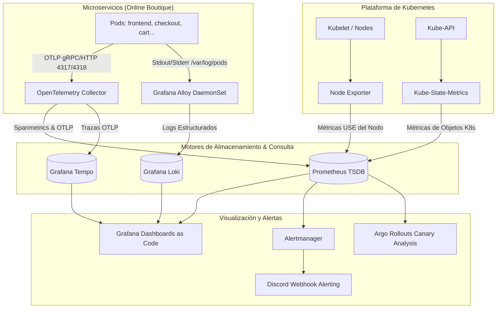
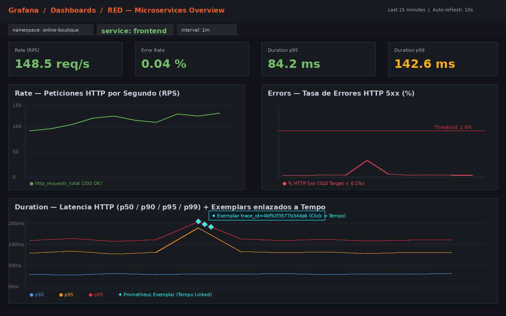
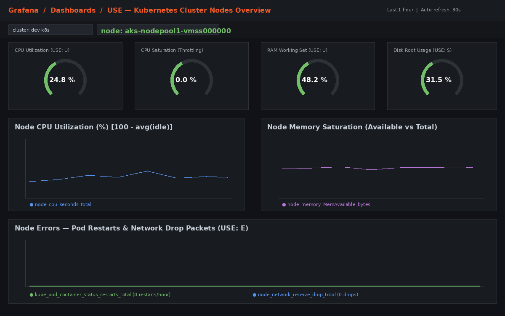
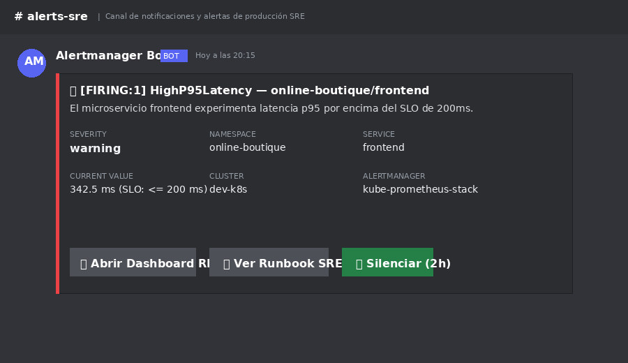

# 🔭 `observability-stack` — Observabilidad Integral como Código

[](https://github.com/miguelortiz13/observability-stack/actions/workflows/ci.yaml)
[](https://prometheus.io/)
[](https://grafana.com/)
[](https://opentelemetry.io/)
[](https://github.com/yannh/kubeconform)

Repositiorio del **Proyecto 4 (`observability-stack`)** del **Laboratorio Integral de DevOps & SRE**. Implementa los **tres pilares de la observabilidad** (métricas, logs y trazas distribuidas) para el sistema de microservicios **Google Online Boutique**, correlacionados de forma nativa en **Grafana**, con tableros, alertas declarativas y análisis de canary automatizados como código.

---

## 🎯 1. Qué Problema Resuelve

En una arquitectura de microservicios distribuida:
1. **Puntos Ciegos:** Un error HTTP 500 en el frontend no revela cuál de los servicios dependientes (`cartservice`, `paymentservice`, `currencyservice`) causó la falla ni por qué.
2. **Alertas Ruidosas o Tardías:** Las alertas tradicionales basadas en consumo bruto de CPU o memoria no indican si los usuarios reales sufren errores o degradación de latencia.
3. **Pérdida de Contexto:** Sin correlación cruzada entre métricas, trazas y logs, el tiempo medio de resolución (MTTR) escala a horas.

`observability-stack` unifica la telemetría en Kubernetes mediante estándares abiertos (OpenTelemetry, PromQL, LogQL, Tempo) garantizando que **desde una alerta se llegue al dashboard, de ahí a la traza lenta y directamente a sus logs**.

---

## 🏛️ 2. Arquitectura de Observabilidad de Extremo a Extremo



---

## 📦 3. Componentes del Stack

| Componente | Rol en la Plataforma | Configuración y Despliegue |
|---|---|---|
| **`kube-prometheus-stack`** | Prometheus Operator, Prometheus TSDB con Exemplars, Alertmanager, Node Exporter, Kube-State-Metrics y Grafana. | Helm chart `prometheus-community/kube-prometheus-stack` v92.1.1 gestionado vía Argo CD. |
| **`Grafana`** | Tableros unificados con provisioning declarativo para dashboards (métodos RED y USE) y datasources enlazados. | Integrado con **External Secrets Operator** para autenticación `admin` desde Azure Key Vault. |
| **`Loki` & `Alloy`** | Ingesta y consulta de logs estructurados con retención eficiente sin indexación pesada de texto completo. | Single-binary / filesystem en dev con Grafana Alloy DaemonSet (P4-02). |
| **`Tempo` & `OTel Collector`** | Almacenamiento de trazas distribuidas e ingesta unificada de instrumentación OTLP (gRPC/HTTP). | Tempo Single-binary y OTel Collector Gateway con spans correlacionados (P4-03). |
| **`Alertmanager` & `PrometheusRule`** | Reglas de alerta SRE (síntomas vs. causas) con `runbook_url` y enrutamiento nativo a Discord. | `PrometheusRule` y `AlertmanagerConfig` integrados con External Secrets (P4-05). |

---

## 🔐 4. Seguridad y Gestión de Secretos (Integración P3-05)

Siguiendo el estándar de seguridad establecido en **P3-05**, las credenciales de administración de Grafana y los Webhooks de notificación no se almacenan en texto plano en Git ni en valores estáticos:
* El secreto `grafana-admin-credentials` se sincroniza dinámicamente desde **Azure Key Vault** (`grafana-admin-user`, `grafana-admin-password`) mediante el `ClusterSecretStore` `azure-keyvault` con **Azure Workload Identity**.
* El secreto `alertmanager-discord-webhook` se sincroniza desde **Azure Key Vault** (`discord-webhook-url`) y es consumido directamente por `AlertmanagerConfig` mediante `apiURL`.
* El chart de Grafana consume directamente el secreto mediante `grafana.admin.existingSecret: grafana-admin-credentials`.

---

## 📊 5. Guías de Telemetría y Consultas

* 📄 [**`docs/promql.md` — 10 Consultas PromQL Esenciales (USE, RED y Burn Rate)**](docs/promql.md)
* 📄 [**`docs/logql.md` — Consultas de Logs con LogQL para Microservicios**](docs/logql.md)
* 📄 [**`docs/tracing.md` — Guía de Trazabilidad Distribuida: OpenTelemetry, Tempo & TraceQL**](docs/tracing.md)
* 📄 [**`docs/dashboards.md` — Dashboards como Código: Métodos RED y USE en Grafana**](docs/dashboards.md)
* 📄 [**`docs/alerting-runbooks.md` — Alertas Accionables a Discord y Catálogo de Runbooks SRE**](docs/alerting-runbooks.md)
* 📄 [**`docs/correlation.md` — Correlación Tridimensional SRE: Métricas ➔ Trazas ➔ Logs**](docs/correlation.md)

---

## 🖼️ 6. Galería de Evidencias y Dashboards como Código

### 6.1. Dashboard RED por Servicio (`dashboards/services-red.json`)
Monitorea los signos vitales de los microservicios bajo el método **RED** (Rate, Errors, Duration) con selector de variables dinámico por microservicio y vinculación de **Exemplars** a Grafana Tempo.



### 6.2. Dashboard USE por Nodo (`dashboards/nodes-use.json`)
Supervisa la salud de la infraestructura de cómputo del clúster bajo el método **USE** (Utilization, Saturation, Errors) para CPU, memoria RAM, disco raíz y reinicios de contenedores.



### 6.3. Alertas Accionables en Discord con Runbooks SRE
Notificación enviada por Alertmanager ante degradación de latencia ($p95 \gt 200\text{ms}$), incorporando enlaces directos al dashboard del servicio y al runbook de mitigación.



---

## 🔗 7. Recorrido de Correlación: Alerta ➔ Dashboard ➔ Traza ➔ Logs (P4-06)


1. **Alerta en Discord (`#alerts`):** Alertmanager notifica el síntoma (`HighP95Latency` / `ErrorBudgetFastBurn`) con enlaces directos al **Dashboard RED** y al **Runbook SRE**.
2. **Métricas ➔ Trazas (Exemplars en Prometheus):** En el panel **Duration — Latencia HTTP** del dashboard RED, los diamantes de **Exemplars (`♦`)** contienen el `trace_id` capturado por OpenTelemetry y `spanmetrics`, abriendo con un clic la traza en **Grafana Tempo**.
3. **Trazas ➔ Logs (`tracesToLogsV2` en Tempo):** Desde el span con error o alta latencia en el waterfall de Tempo, el enlace **"Logs for this span"** abre **Grafana Loki** filtrado por `namespace`, `service_name` y `trace_id`.
4. **Logs ➔ Trazas (`derivedFields` en Loki):** Cada línea de log JSON o logfmt que incluye `trace_id` expone automáticamente el botón **"Ver traza en Tempo"**.

---

## ⚡ 8. Consumo de Recursos del Stack (FinOps & Dimensionamiento)

El stack de observabilidad fue dimensionado minuciosamente para operar dentro de un clúster de desarrollo/pruebas (`dev-k8s`) manteniendo **cero sobrecostos** y máxima estabilidad:

| Componente | CPU Requests | CPU Limits | Memory Requests | Memory Limits | Estrategia de Almacenamiento |
|---|---|---|---|---|---|
| **Prometheus TSDB** | `100m` | `500m` | `256Mi` | `512Mi` | `emptyDir` (24h retención / 5GiB) |
| **Prometheus Operator** | `50m` | `200m` | `128Mi` | `256Mi` | Stateless |
| **Alertmanager** | `25m` | `100m` | `64Mi` | `128Mi` | `emptyDir` (24h retención) |
| **Grafana** | `50m` | `250m` | `128Mi` | `256Mi` | Stateless (Dashboards/Datasources as Code) |
| **Node Exporter (por nodo)** | `20m` | `100m` | `32Mi` | `64Mi` | Host access |
| **Kube-State-Metrics** | `20m` | `100m` | `64Mi` | `128Mi` | Stateless |
| **Grafana Loki** | `50m` | `200m` | `128Mi` | `256Mi` | Filesystem efímero en dev (retención 24h) |
| **Grafana Alloy (DaemonSet)** | `25m` | `100m` | `64Mi` | `128Mi` | Ingesta de `/var/log/pods` |
| **Grafana Tempo** | `50m` | `200m` | `128Mi` | `256Mi` | Filesystem en bloque en dev (retención 24h) |
| **OpenTelemetry Collector** | `50m` | `200m` | `64Mi` | `256Mi` | Ingesta en memoria con batching |
| **TOTAL CONSOLIDADO** | **`440m` (~0.44 núcleos)** | **`2150m`** | **`1056Mi` (~1.03 GiB)** | **`2368Mi` (~2.3 GiB)** | **Cero costos de nube adicionales ($0.00)** |

---

## 🛠️ 9. Validación Local y Automatización

El repositorio incluye un `Makefile` para validar los templates y esquemas OpenAPI offline:

```bash
# Mostrar menú de comandos disponibles
make help

# Validar sintaxis y compilación del chart
make lint

# Validar contra los esquemas OpenAPI oficiales de Kubernetes con Kubeconform
make validate
```
