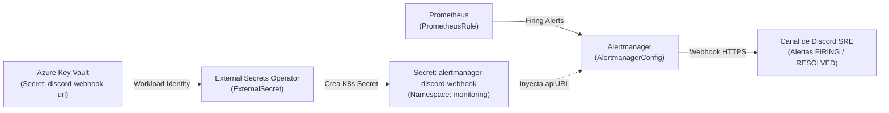

# 🚨 Alertas Accionables con Alertmanager, Discord y Catálogo de Runbooks SRE

Este documento define la arquitectura de alertamiento declarativo implementada en `observability-stack` y `platform-gitops`, fundamentada en los principios del **Google SRE Book**, junto con los **Runbooks operativos** vinculados desde cada regla mediante la anotación `runbook_url`.

---

## 1. Filosofía SRE: Alertas por Síntoma vs. Alertas por Causa

Para evitar la fatiga de alertas (*alert fatigue*), clasificamos todas nuestras reglas en dos categorías mediante la etiqueta `alert_type`:

| Categoría (`alert_type`) | Qué mide | Severidad típica | Ejemplos en Online Boutique |
|---|---|---|---|
| **Síntoma (`symptom`)** | Dolor real experimentado por el usuario final (errores HTTP 5xx, latencia excesiva, servicio caído). | `critical` / `warning` | `FrontendHighErrorRate`, `OnlineBoutiqueServiceUnavailable`, `FrontendHighLatencyP95` |
| **Causa (`cause`)** | Degradación en componentes subyacentes de infraestructura o plataforma que explica o anticipa un síntoma. | `warning` / `critical` | `PodCrashLooping`, `PodNotReady`, `NodeMemoryPressure`, `NodeHighCPUUtilization` |

---

## 2. Arquitectura de Enrutamiento y Seguridad (Key Vault ➔ ESO ➔ Alertmanager ➔ Discord)



### Routing, Agrupación e Inhibición (`AlertmanagerConfig`)
* **`groupBy: ['alertname', 'namespace', 'severity']`**: Agrupa múltiples alertas similares (por ejemplo, varios pods cayendo simultáneamente en `online-boutique`) en un único mensaje consolidado de Discord.
* **Tiempos de Entrega**:
  * Alertas `critical`: `groupWait: 10s`, `repeatInterval: 1h`.
  * Alertas `warning`: `groupWait: 30s`, `repeatInterval: 4h`.
* **Regla de Inhibición (`inhibitRules`)**: Si una alerta con `severity="critical"` está activa, silencia automáticamente las alertas `severity="warning"` que compartan el mismo `alertname` y `namespace`, reduciendo el ruido durante incidentes mayores.
* **`sendResolved: true`**: Notifica automáticamente al canal de Discord con estado `✅ [RESOLVED]` tan pronto la métrica vuelve a su umbral normal.

---

## 3. Catálogo de Runbooks Operativos

Cada alerta definida en `alerts/prometheus-rules.yaml` incluye la anotación `runbook_url` apuntando directamente a su sección correspondiente en este documento.

---

### `FrontendHighErrorRate`
* **Severidad:** `critical` | **Tipo:** `symptom`
* **Condición:** Tasa de respuestas HTTP `5xx` en `frontend` > `5%` durante `2m`.
* **Impacto:** Los usuarios están recibiendo errores al navegar el catálogo o procesar compras (`checkout`).
* **Diagnóstico:**
  1. Revisar el dashboard **RED Method** (`online-boutique-red`) filtrando por `frontend`.
  2. Consultar logs de error en Grafana Loki:
     ```logql
     {namespace="online-boutique", app="frontend"} |= "error"
     ```
  3. Extraer un `trace_id` de los logs y abrirlo en **Grafana Tempo** para identificar qué dependencia gRPC (`cartservice`, `checkoutservice`, `productcatalogservice`) está originando el fallo.
* **Mitigación:**
  * Si se produjo tras un despliegue reciente del `frontend`, abortar o revertir el `Rollout`:
    ```bash
    kubectl argo rollouts abort frontend -n online-boutique
    kubectl argo rollouts undo frontend -n online-boutique
    ```
  * Si un microservicio backend está en `0` réplicas o `CrashLoopBackOff`, seguir el runbook específico de ese componente.

---

### `FrontendHighLatencyP95`
* **Severidad:** `warning` | **Tipo:** `symptom`
* **Condición:** Latencia percentil 95 (`p95`) en `frontend` > `500ms` durante `5m`.
* **Impacto:** Experiencia de usuario degradada y riesgo de abandono en el flujo de compra.
* **Diagnóstico:**
  1. Buscar trazas lentas en **Grafana Tempo** con TraceQL:
     ```traceql
     { resource.service.name = "frontend" && duration > 500ms }
     ```
  2. Verificar si existe estrangulamiento de CPU (*CPU Throttling*) en los contenedores del namespace `online-boutique`.
* **Mitigación:**
  * Escalar horizontalmente el microservicio cuello de botella o ajustar sus `resources.limits.cpu` mediante Pull Request en `platform-gitops`.

---

### `OnlineBoutiqueServiceUnavailable`
* **Severidad:** `critical` | **Tipo:** `symptom`
* **Condición:** `kube_deployment_status_replicas_available{namespace="online-boutique"} == 0` durante `1m`.
* **Impacto:** Caída total de un microservicio de negocio (ej. `cartservice`, `paymentservice`, `checkoutservice`).
* **Diagnóstico:**
  1. Verificar el estado de los Deployments y Pods:
     ```bash
     kubectl get deployments,pods -n online-boutique
     ```
  2. Inspeccionar eventos del Deployment afectado:
     ```bash
     kubectl describe deployment <nombre-servicio> -n online-boutique
     ```
* **Mitigación:**
  * Si el servicio fue escalado manualmente a `0` réplicas, restaurar el conteo deseado o permitir que Argo CD ejecute `selfHeal`:
    ```bash
    kubectl scale deployment <nombre-servicio> -n online-boutique --replicas=1
    ```

---

### `PodCrashLooping`
* **Severidad:** `critical` | **Tipo:** `cause`
* **Condición:** Contenedor en `CrashLoopBackOff` o con reinicios continuos en los últimos 15 minutos durante `2m`.
* **Impacto:** Capacidad reducida del servicio o indisponibilidad inminente.
* **Diagnóstico:**
  1. Inspeccionar el código de salida (`Exit Code`) y razón de terminación (`OOMKilled` = 137, `Error` = 1):
     ```bash
     kubectl describe pod <pod-name> -n online-boutique
     ```
  2. Consultar los logs del contenedor previo antes de morir:
     ```bash
     kubectl logs <pod-name> -n online-boutique --previous
     ```
* **Mitigación:**
  * Si la razón es `OOMKilled` (`Exit Code 137`), incrementar `resources.limits.memory` en el overlay de Kustomize en `platform-gitops`.
  * Si es un fallo de conexión a una dependencia (ej. `redis-cart`), verificar la salud del servicio dependiente.

---

### `PodNotReady`
* **Severidad:** `warning` | **Tipo:** `cause`
* **Condición:** Pod en fase `Pending`, `Unknown` o `Failed` durante más de `5m`.
* **Diagnóstico:**
  ```bash
  kubectl get events -n online-boutique --sort-by='.lastTimestamp'
  ```
  Verificar si hay falta de recursos en los nodos (`Insufficient cpu/memory`) o errores de extracción de imagen (`ImagePullBackOff`).

---

### `NodeMemoryPressure`
* **Severidad:** `warning` | **Tipo:** `cause`
* **Condición:** Utilización de memoria del nodo > `85%` o condición `MemoryPressure=true` durante `5m`.
* **Impacto:** Riesgo de desalojo (*eviction*) de pods por parte del Kubelet o activación del `OOMKiller` del kernel.
* **Diagnóstico:**
  1. Abrir el dashboard **USE Method** (`k8s-nodes-use`) y revisar el panel de *Memoria Usada* y *Major Page Faults*.
  2. Identificar los pods con mayor consumo de memoria en el nodo:
     ```bash
     kubectl top pods -A --sort-by=memory
     ```
* **Mitigación:**
  * Verificar que todos los workloads tengan `resources.limits.memory` definidos y escalar el node pool si la carga legítima supera la capacidad.

---

### `NodeHighCPUUtilization`
* **Severidad:** `warning` | **Tipo:** `cause`
* **Condición:** Utilización de CPU del nodo > `85%` durante `5m`.
* **Diagnóstico:**
  1. Revisar en el dashboard **USE Method** (`k8s-nodes-use`) el ratio `Load 1m / Cores`.
  2. Identificar contenedores ruidosos:
     ```bash
     kubectl top pods -A --sort-by=cpu
     ```

---

## 4. Prueba Práctica (GameDay): Escalando `cartservice` a 0 Réplicas

Para validar de extremo a extremo el ciclo de vida de una alerta (`Pending` ➔ `Firing` ➔ `Discord` ➔ `Resolved`):

### Paso 1: Desactivar temporalmente `selfHeal` en Argo CD (para evitar que Argo CD lo restaure en segundos) y escalar `cartservice` a 0
```bash
# Escalar cartservice a 0 réplicas para provocar la caída del carrito de compras
kubectl scale deployment cartservice -n online-boutique --replicas=0
```

### Paso 2: Verificar transición de la alerta en Prometheus y Alertmanager
1. A los **30 segundos**, la regla `OnlineBoutiqueServiceUnavailable` (y `FrontendHighErrorRate` si el `loadgenerator` está enviando tráfico de compra) entra en estado **`PENDING`**.
2. Tras **1 minuto** (`for: 1m`), la alerta pasa a estado **`FIRING`** y se envía a Alertmanager.
3. Pasados los **10 segundos** de `groupWait` para severidad `critical`, el bot **`Alertmanager SRE Bot`** publica en el canal de Discord:
   > 🚨 **[FIRING:1] OnlineBoutiqueServiceUnavailable**
   > **Severidad:** `critical` | **Tipo:** `symptom`
   > • **Resumen:** Servicio cartservice sin réplicas disponibles en online-boutique
   > • **Detalle:** El Deployment cartservice en el namespace online-boutique tiene 0 réplicas disponibles durante más de 1 minuto, degradando las operaciones de negocio.
   > • **Runbook:** `https://github.com/miguelortiz13/observability-stack/blob/main/docs/alerting-runbooks.md#onlineboutiqueserviceunavailable`

### Paso 3: Restaurar el servicio y verificar notificación de resolución
```bash
# Restaurar cartservice a 1 réplica
kubectl scale deployment cartservice -n online-boutique --replicas=1
```
Una vez el pod de `cartservice` pasa a `Ready`, Prometheus evalúa la condición como falsa y Alertmanager envía automáticamente el mensaje a Discord:
> ✅ **[RESOLVED] OnlineBoutiqueServiceUnavailable**
