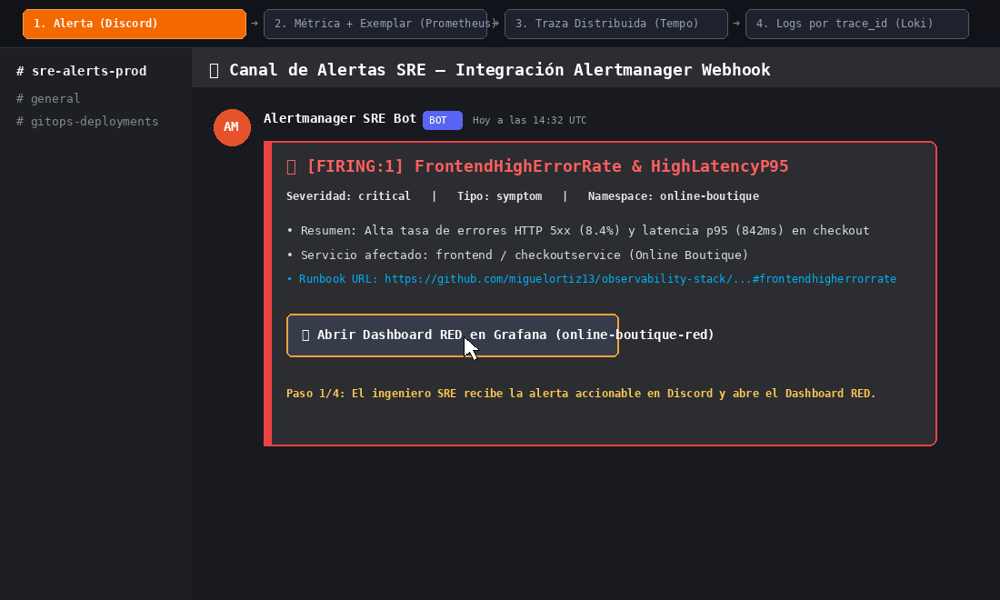
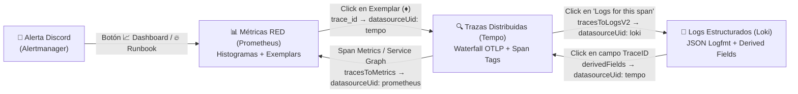

# Correlación Tridimensional SRE: Métricas ➔ Trazas ➔ Logs

> **Referencia de tarea:** `P4-06` (#45) — *Correlación métricas → trazas → logs*

En este laboratorio, los tres pilares de observabilidad (**Prometheus**, **Grafana Tempo** y **Grafana Loki**) están interconectados de forma nativa en Grafana para permitir investigar incidentes desde un síntoma macroscópico (alerta o SLO burn rate) hasta la línea exacta de log y el span específico que originó el fallo, sin perder el contexto (`service`, `namespace`, `pod`, `trace_id`, `span_id`).

---

## Recorrido Visual End-to-End (Alerta ➔ Dashboard RED ➔ Tempo ➔ Loki)



---

## Arquitectura de Enlaces de Correlación



---

## 1. De Métricas a Trazas: Exemplars en Prometheus

Para pasar de un pico de latencia $p95$/$p99$ en un gráfico de series temporales directamente a una traza real que sufrió esa latencia:

1. **Almacenamiento en Prometheus (`helm/kube-prometheus-stack/values.yaml`):**
   - Se habilita el feature flag `enableFeatures: ["exemplar-storage"]` y `exemplars.maxSize: 50000` en `prometheus.prometheusSpec`.
2. **Generación de Exemplars con OpenTelemetry (`helm/opentelemetry-collector/values.yaml`):**
   - El SDK de OpenTelemetry en los microservicios adjunta automáticamente el `trace_id` y `span_id` activos a las mediciones de histogramas HTTP (`http_server_request_duration_seconds_bucket`).
   - Adicionalmente, el **OpenTelemetry Collector** incorpora el conector `spanmetrics` (`connectors.spanmetrics`) con `exemplars.enabled: true` y exporta en formato **OpenMetrics** (`enable_open_metrics: true` en el exporter `prometheus`), generando histogramas enriquecidos con `trace_id` para cualquier servicio instrumentado con trazas OTLP.
3. **Enlace en el Datasource de Prometheus (`exemplarTraceIdDestinations`):**
   ```yaml
   grafana:
     sidecar:
       datasources:
         exemplarTraceIdDestinations:
           datasourceUid: tempo
           traceIdLabelName: trace_id
   ```
4. **Visualización en el Dashboard RED (`dashboards/services-red.json`):**
   - Los targets del panel **Duration — Latencia HTTP (p50 / p90 / p95 / p99) + Exemplars** tienen `"exemplar": true`, renderizando diamantes (`♦`) sobre la gráfica. Al hacer clic en un diamante, Grafana abre directamente la traza en **Grafana Tempo**.

---

## 2. De Trazas a Logs: `tracesToLogsV2` en Grafana Tempo

Configurado en [`helm/tempo/loki-datasource.yaml`](../helm/tempo/loki-datasource.yaml) dentro del datasource `Tempo` (`uid: tempo`):

```yaml
tracesToLogsV2:
  datasourceUid: loki
  spanStartTimeShift: "-1m"
  spanEndTimeShift: "1m"
  filterByTraceID: false
  filterBySpanID: false
  customQuery: true
  query: '{namespace="${__span.tags["k8s.namespace.name"]}", service_name="${__span.tags["service.name"]}"} |="${__trace.traceId}"'
  tags:
    - key: service.name
      value: service_name
    - key: k8s.namespace.name
      value: namespace
    - key: k8s.pod.name
      value: pod
```

* Al inspeccionar cualquier span en el waterfall de Tempo, el botón **"Logs for this span"** abre un panel dividido en Grafana Explore ejecutando automáticamente la consulta LogQL en Loki acotada a $\pm 1\text{ min}$ del span y filtrando por `${__trace.traceId}`.

---

## 3. De Logs a Trazas: `derivedFields` en Grafana Loki

Configurado en [`helm/loki/loki-datasource.yaml`](../helm/loki/loki-datasource.yaml) (y consolidado en `helm/tempo/loki-datasource.yaml`) dentro del datasource `Loki` (`uid: loki`):

```yaml
derivedFields:
  - datasourceUid: tempo
    matcherRegex: '(?:trace_id|traceId|traceID)["=:\s]+([a-fA-F0-9]{16,32})'
    name: TraceID
    url: "$${__value.raw}"
    urlDisplayLabel: "Ver traza en Tempo"
```

* Cualquier línea de log en formato JSON (`{"trace_id": "4bf92f3577b34da6a3ce929d0e0e4736", ...}`) o key-value (`trace_id=4bf92f3577b34da6a3ce929d0e0e4736`) detectada por la expresión regular genera automáticamente un botón **"Ver traza en Tempo"** dentro del detalle del log en Grafana.

---

## 4. Guía Paso a Paso durante un Incidente

1. **Recepción de Alerta en Discord (`#alerts`):**
   - Alertmanager envía la notificación enriquecida (ej. `[FIRING:1] HighP95Latency`) con botones directos a **📈 Dashboard**, **🔥 Runbook** y **🔕 Silenciar**.
2. **Inspección en Dashboard `RED — Microservices Overview`:**
   - Seleccionar el `namespace` y `service` afectados en las variables superiores.
   - En el panel **Duration — Latencia HTTP**, identificar los diamantes de **Exemplars (`♦`)** en la cresta de latencia $p95$/$p99$ o usar los **Data Links** del panel para saltar a Tempo/Loki.
3. **Análisis de Causa Raíz en Tempo:**
   - Al hacer clic en el Exemplar (`trace_id`), se abre la vista de cascada (*waterfall*) mostrando qué span interno o llamada saliente consumió el tiempo o devolvió `status=ERROR`.
   - Hacer clic en **"Logs for this span"** en el span problemático.
4. **Evidencia Exacta en Loki:**
   - Revisar el stacktrace o mensaje de error exacto correlacionado por `trace_id`, y usar el enlace `TraceID` (*Derived Field*) si se desea volver a navegar hacia otras trazas relacionadas.
